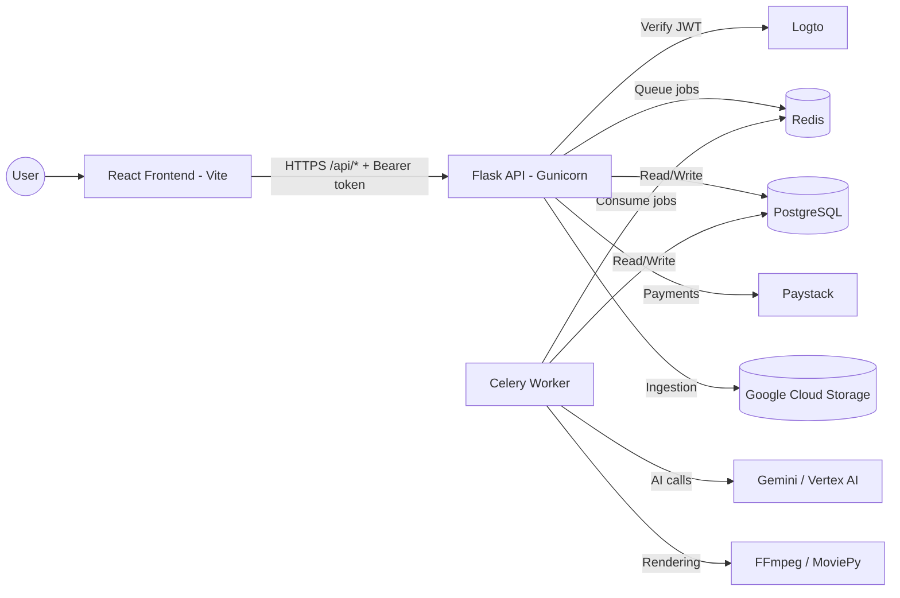

# LiveEdit — AI-Powered Video Editor
[](https://github.com/clencyc/LiveEdit/actions/workflows/tests.yml)

LiveEdit is a full-stack app for AI-driven video analysis, editing and generation, built on Google Gemini. A React frontend talks to a Flask API; long-running work (analysis, rendering) runs asynchronously in Celery workers.

**Live app:** https://livedit.space

## Features

- **AI chat** with Gemini, including selectable audio effects for edits
- **Video analysis**: upload a clip, get a summary, key events and an edit plan (async job)
- **Video editing / multi-clip editing**: render an edit plan with FFmpeg/MoviePy (async job)
- **Video ingestion**: upload once, then query the video, get scene summaries and Video Intelligence metadata
- **AI Director**: a session-based workflow that converses about a creative brief, produces a structured edit plan and renders it
- **Image generation** and **AI video generation**
- **Workflow canvas** for chaining steps visually
- **Accounts and subscriptions**: Logto sign-in, Paystack payments (KES)

## Architecture



**Request flow for heavy work:** the frontend calls an endpoint such as `POST /api/analyze-video`. The API stores the upload, inserts a row in `video_jobs`, enqueues a Celery task and returns `202` with a `job_id`. The frontend polls `GET /api/video-jobs/<job_id>` and downloads the result from `/api/video-jobs/<job_id>/download`.

## Project structure

```
LiveEdit/
├── LiveEditBackend/            # Flask API + Celery workers
│   ├── app.py                  # Flask app: auth gate, routes, DB setup
│   ├── ai_client.py            # Gemini / Vertex AI client factory
│   ├── logto_auth.py           # Logto JWT verification
│   ├── celery_config.py        # Celery app (Redis broker/backend)
│   ├── video_tasks.py          # Async tasks: analyze, edit, edit-multi
│   ├── video_ingestion.py      # Upload, cache, query, scene summaries
│   ├── video_director.py       # AI Director sessions, planning, rendering
│   ├── init_db.py              # Seeds the audio_effects table
│   ├── sounds/                 # Audio effect library
│   ├── tests/                  # pytest suite
│   ├── Dockerfile, start.sh    # Production start (gunicorn + Celery)
│   └── start-celery.sh         # Local Celery worker
├── LiveEditFronten/            # React 19 + TypeScript + Vite frontend
│   ├── App.tsx, index.tsx
│   ├── components/             # Chat, Director, Ingestion, Workflow, Payments...
│   ├── services/               # API clients (Gemini + backend)
│   └── __tests__/
├── docs/                       # Auth, deployment-fix and feature notes
├── .github/workflows/tests.yml # CI: backend pytest, frontend tests (70% coverage gate)
├── setup.sh, start-backend.sh, start-frontend.sh
└── ARCHITECTURE_DIAGRAM.md, DEPLOYMENT.md, TESTING.md, CONTRIBUTING.md
```

> The frontend folder is spelled `LiveEditFronten` in the repo. Use that name in all commands.

## Prerequisites

- Python 3.11+
- Node.js 18+ (the repo is built with Vite 6)
- PostgreSQL (the project uses Neon in production)
- Redis (a local `redis-server` works; Upstash `rediss://` URLs are supported)
- FFmpeg
- A Logto application (for sign-in)
- Either a Gemini API key **or** a Google Cloud project with Vertex AI enabled

## Quick start

### Option 1: setup script

```bash
chmod +x setup.sh
./setup.sh
```

### Option 2: manual

**Backend**

```bash
cd LiveEditBackend
python3 -m venv venv
source venv/bin/activate
pip install -r requirements.txt
cp .env.example .env        # if present; otherwise create .env (see Configuration)
python app.py               # http://localhost:5000
```

**Celery worker** (new terminal; required for analysis and rendering)

```bash
cd LiveEditBackend
./start-celery.sh
```

**Frontend** (new terminal)

```bash
cd LiveEditFronten
npm install
npm run dev                 # http://localhost:5173
```

## Configuration

### Backend (`LiveEditBackend/.env`)

| Variable | Required | Description |
| --- | --- | --- |
| `DATABASE_URL` | Yes | PostgreSQL connection string |
| `REDIS_URL` | Yes | Redis URL (default `redis://localhost:6379/0`) |
| `LOGTO_ENDPOINT` | Yes | Logto tenant endpoint (token issuer) |
| `LOGTO_APP_ID` | Yes | Logto application ID (token audience) |
| `USE_VERTEX_AI` | No | `true` (the default) uses Vertex AI; set `false` to use an API key |
| `GEMINI_API_KEY` | If not using Vertex | Gemini API key. Image generation always needs it |
| `VERTEX_PROJECT_ID` | If using Vertex | Google Cloud project (falls back to `GOOGLE_CLOUD_PROJECT`) |
| `VERTEX_LOCATION` | No | Default `us-central1` |
| `GEMINI_TEXT_MODEL` / `GEMINI_VIDEO_MODEL` | No | Default `gemini-2.0-flash` |
| `GEMINI_IMAGE_MODEL` | No | Default `imagen-3.0-generate-001` |
| `GEMINI_API_TIMEOUT` | No | Seconds, default `120` |
| `GCS_PROJECT_ID`, `GCS_BUCKET_NAME`, `GCS_BUCKET_LOCATION` | For ingestion | Google Cloud Storage for uploaded videos |
| `PAYSTACK_SECRET_KEY` | For payments | Paystack secret key |
| `FRONTEND_URL` / `FRONTEND_URLS` | Production | Extra allowed CORS origins (comma-separated) |
| `ENABLE_ANALYSIS_CACHE` / `CACHE_TTL` | No | Redis cache for analysis results |
| `JOB_WORKDIR` | No | Shared job directory, default `/tmp/liveedit_jobs` |
| `PORT` | No | Default `5000` for `python app.py` |
| `CELERY_BROKER_HEARTBEAT`, `CELERY_PREFETCH` | No | Celery tuning |

For Vertex AI, authenticate with `GOOGLE_APPLICATION_CREDENTIALS` or `gcloud auth application-default login`.

### Frontend (`LiveEditFronten/.env.local`)

| Variable | Description |
| --- | --- |
| `VITE_BACKEND_URL` | Backend base URL, e.g. `http://localhost:5000` (`VITE_API_URL` is accepted as a fallback) |
| `VITE_LOGTO_ENDPOINT` | Logto tenant endpoint |
| `VITE_LOGTO_APP_ID` | Logto application ID |
| `VITE_GEMINI_API_KEY` | Gemini key for features that call Gemini directly from the browser |

> **Security note:** any `VITE_*` value is bundled into the public JavaScript. Do not put a key there that you are not willing to expose, and restrict it by HTTP referrer in Google Cloud.

## Authentication

Every `/api/*` request must send `Authorization: Bearer <Logto access token>`, except `GET /api/payments/plans`. On first sign-in the frontend calls `GET /api/auth/session`, which creates or links the LiveEdit account (a verified email is required). See `docs/LOGTO_AUTH.md` for setup.

## API overview

All routes are prefixed `/api` except `/health`.

| Area | Endpoints |
| --- | --- |
| Health | `GET /health` |
| Auth | `GET /auth/session` |
| Chat / images | `POST /chat`, `POST /generate-image` |
| Audio effects | `GET /audio-effects`, `GET /audio-effects/<filename>`, `POST /audio-effects/import` |
| Analysis and editing (async) | `POST /analyze-video`, `POST /edit-video`, `POST /edit-multi` |
| Jobs | `GET /video-jobs/<job_id>`, `GET /video-jobs/<job_id>/download` |
| Ingestion | `POST /video-ingestion/upload`, `/query`, `/scene-summary`, `/video-intelligence`; `GET /video-ingestion/files` |
| AI Director | `POST /video-director/session/start`, `/interaction`, `/plan`, `/render`; `GET /video-director/render/<id>`, `/session/<id>` |
| Payments | `GET /payments/plans`, `POST /payments/initialize`, `GET /payments/verify/<reference>` |
| Account | `GET /user/subscription`, `GET /user/transactions` |
| Cache | `GET /cache/stats`, `POST /cache/clear` |

### Example: analyze a video

```bash
curl -X POST http://localhost:5000/api/analyze-video \
  -H "Authorization: Bearer $TOKEN" \
  -F "video_file=@video.mp4" \
  -F "prompt=Suggest cuts to tighten this video"
# -> 202 {"job_id": "...", "status": "queued", "job_type": "analyze", ...}

curl -H "Authorization: Bearer $TOKEN" http://localhost:5000/api/video-jobs/<job_id>
```

## Testing

```bash
# Backend
cd LiveEditBackend && pip install pytest pytest-cov && pytest

# Frontend
cd LiveEditFronten && npm test
```

CI (`.github/workflows/tests.yml`) runs both suites and enforces 70% coverage. See `TESTING.md` for details.

## Deployment

- **Backend:** build `LiveEditBackend/Dockerfile`. `start.sh` runs Celery in the background and serves the API with gunicorn on `$PORT` (default `10000`). Set the environment variables above and add your frontend origin to `FRONTEND_URL`.
- **Frontend:** `npm run build` in `LiveEditFronten`, then deploy to Vercel or Firebase Hosting (config for both is included). Set `VITE_BACKEND_URL` at build time.

See `DEPLOYMENT.md` for the full guide and `docs/` for notes on past fixes (cookies/SameSite, Gemini retries, quota, multi-clip).

## Troubleshooting

- **`DATABASE_URL not found`:** create `LiveEditBackend/.env` and set it.
- **Jobs stay `queued`:** the Celery worker is not running, or it cannot reach `REDIS_URL`.
- **`401` / `503 Authentication service unavailable`:** check `LOGTO_ENDPOINT` and `LOGTO_APP_ID` on the backend and that the frontend sends a Bearer token.
- **CORS errors:** add your frontend origin to `FRONTEND_URL`.
- **Gemini errors on startup:** with `USE_VERTEX_AI=true` (the default) you need `VERTEX_PROJECT_ID` and Google credentials; otherwise set `USE_VERTEX_AI=false` and `GEMINI_API_KEY`.
- **Port 5000 in use:** `lsof -i :5000`, then stop that process or set `PORT`.

## Contributing

1. Create a feature branch
2. Make your changes and add tests
3. Run both test suites locally
4. Open a PR with a description (see `CONTRIBUTING.md`)

## License

MIT (see [LICENSE](LICENSE)).